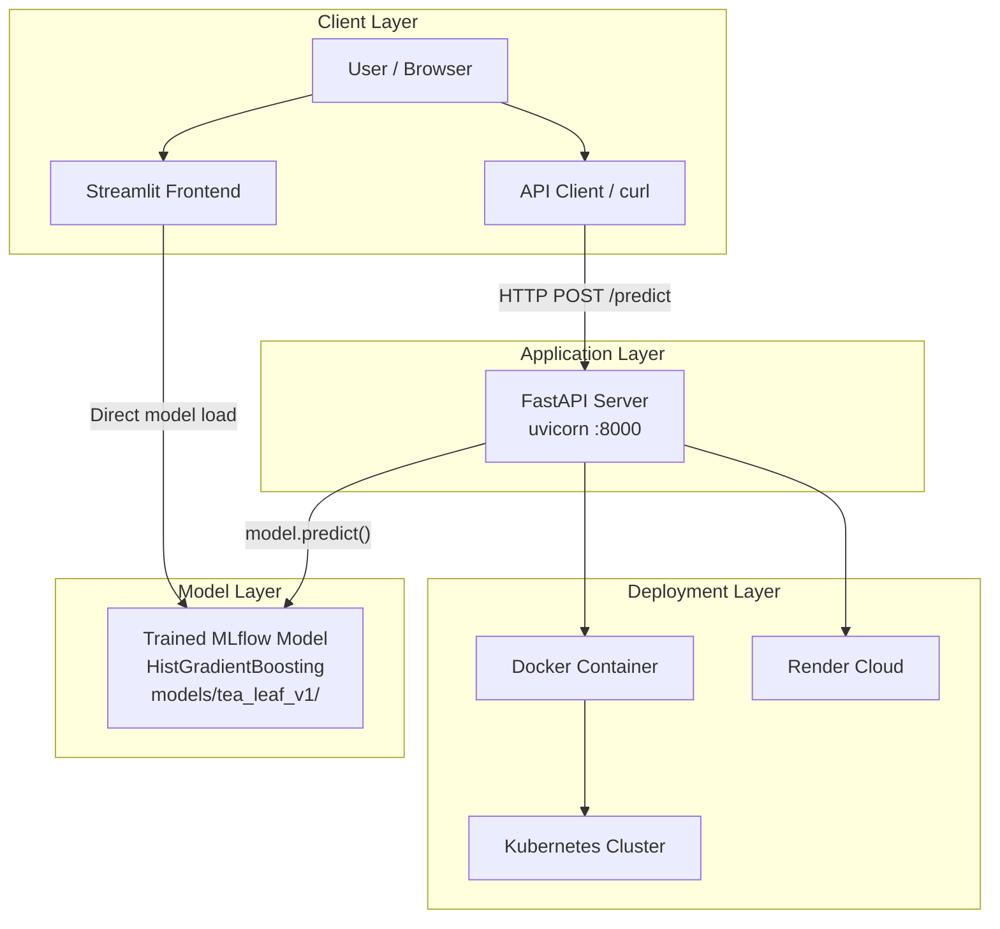

# Deployment Documentation — Shubham Mittal

**Student:** Shubham Mittal
**Enrollment:** S24CSEU2764
**Course:** SCSE3040 — MLOps
**Group:** G055 | **Problem ID:** MP148
**Project:** Tea Leaf Yield Prediction

---

## Assigned Responsibilities

| # | Task | Status |
|---|------|--------|
| 1 | Docker containerization | ✅ Completed |
| 2 | Docker image optimization | ✅ Completed |
| 3 | Docker container testing | ✅ Completed |
| 4 | Kubernetes Deployment | ✅ Completed |
| 5 | Kubernetes Service | ✅ Completed |
| 6 | Readiness and liveness probes | ✅ Completed |
| 7 | Application and prediction logging | ✅ Completed |
| 8 | Docker and deployment testing in CI | ✅ Completed |
| 9 | Deployment verification | See results below |
| 10 | Documentation | ✅ This document |
| 11 | GitHub commits and push | ✅ Completed |

---

## Architecture



> [!NOTE]
> The Streamlit frontend loads the model directly using `mlflow.sklearn.load_model()` — it does **not** call the FastAPI API. The FastAPI service is used by API clients, the Docker container, and Kubernetes pods.

---

## Docker Implementation

### Dockerfile

The Dockerfile is a single-stage production build optimized for the FastAPI model-serving application.

| Layer | Purpose |
|-------|---------|
| `python:3.12-slim` | Minimal Python 3.12 base image (~50 MB) |
| `COPY requirements.txt` + `pip install` | Cached dependency layer |
| `COPY app.py`, `streamlit_app.py`, `models/` | Application code and model artifacts |
| `useradd appuser` + `USER appuser` | Non-root execution for security |
| `HEALTHCHECK` | Built-in Docker health monitoring |
| `EXPOSE 8000` | Declares the application port |
| `CMD uvicorn` | Production server bound to `0.0.0.0:8000` |

### .dockerignore

Excludes `.git`, `.venv`, `data/`, `mlruns/`, `tests/`, `notebooks/`, `docs/`, `src/` and other non-serving files from the Docker context, reducing image size and build time.

### Build and Run Commands

```bash
# Build the Docker image
docker build -t mp148-api:1.0 .

# Run the container
docker run -d --name mp148-api -p 8000:8000 mp148-api:1.0

# Check container status
docker ps

# View logs
docker logs mp148-api

# Test health endpoint
curl http://localhost:8000/health

# Test prediction endpoint
curl -X POST http://localhost:8000/predict \
  -H "Content-Type: application/json" \
  -d '{"worker_exp_yr":48,"rain_mm_week":285,"slope_deg":21,"temp_c":15.9,"bush_age_yr":10,"hours_worked":5.4,"flush":"monsoon","section":"River Side"}'

# Stop and remove container
docker stop tea-leaf-api && docker rm tea-leaf-api
```

---

## Kubernetes Implementation

### Deployment (`k8s/deployment.yaml`)

| Setting | Value | Rationale |
|---------|-------|-----------|
| Replicas | 3 | High availability and load distribution |
| Strategy | RollingUpdate (maxSurge=1, maxUnavailable=0) | Zero-downtime deployments |
| CPU request / limit | 100m / 500m | Sufficient for inference workload |
| Memory request / limit | 256Mi / 512Mi | Covers model loading (~2 MB model) |
| Image pull policy | Never | Use locally built image |
| Security | runAsNonRoot | Matches Docker non-root user |

### Service (`k8s/service.yaml`)

| Setting | Value |
|---------|-------|
| Type | ClusterIP (internal) |
| Port | 80 (external) → 8000 (container) |
| Selector | `app: tea-leaf-api` |

### Health Probes

| Probe | Endpoint | Purpose | Timing |
|-------|----------|---------|--------|
| **Startup** | `GET /health` | Allow model loading time | initialDelay=5s, period=5s, failures=12 (up to 60s) |
| **Readiness** | `GET /ready` | Only route traffic when model is loaded | initialDelay=10s, period=10s |
| **Liveness** | `GET /health` | Restart if app becomes unresponsive | initialDelay=15s, period=15s |

The `/ready` endpoint returns `200` only when the model is successfully loaded. The `/health` endpoint returns `"healthy"` or `"unhealthy"` based on model state.

### Deployment Commands

```bash
# Apply manifests
kubectl apply -f k8s/deployment.yaml
kubectl apply -f k8s/service.yaml

# Check rollout
kubectl rollout status deployment/mp148-api --timeout=180s
kubectl get pods -o wide
kubectl get services

# View logs
kubectl logs deployment/mp148-api

# Port forward for local testing
kubectl port-forward service/mp148-svc 8080:80

# Test through port-forward
curl http://localhost:8080/health
curl -X POST http://localhost:8080/predict \
  -H "Content-Type: application/json" \
  -d '{"worker_exp_yr":48,"rain_mm_week":285,"slope_deg":21,"temp_c":15.9,"bush_age_yr":10,"hours_worked":5.4,"flush":"monsoon","section":"River Side"}'
```

---

## Application Logging

The logging implementation uses Python's standard `logging` module with structured output to `stdout`.

### Log Format

The application emits structured, machine-readable JSON per line on `stdout`:

```json
{"timestamp": "2026-11-28T06:13:00.123456+00:00", "level": "INFO", "logger": "tea_leaf_api", "message": "Prediction successful: yield=24.39 kg/worker in 1.42 ms", "event": "prediction_success", "request_id": "a1b2c3d4-e5f6-7890-abcd-ef1234567890", "endpoint": "/predict", "method": "POST", "status_code": 200, "model_version": 4, "prediction": 24.39, "latency_ms": 1.42}
```

### Logged Events

| Event | Level | Details |
|-------|-------|---------|
| Application startup | INFO | Startup banner |
| Model loading start | INFO | Model path |
| Model loading success | INFO | Confirmation |
| Model loading failure | ERROR | Full traceback |
| Prediction request | INFO | Flush and section values |
| Prediction success | INFO | Result value and elapsed time |
| Prediction failure | ERROR | Traceback and elapsed time |
| Readiness check failure | WARNING | Model not loaded |
| Application shutdown | INFO | Shutdown banner |

### Security

- No credentials or tokens are logged.
- Full request bodies are not logged — only non-sensitive feature metadata (flush, section).
- Internal stack traces are not returned to API callers.

---

## CI Workflow Changes

The GitHub Actions workflow (`.github/workflows/ci.yml`) was extended with two new jobs:

### Job: `docker`

Builds the Docker image, starts a container, and runs smoke tests:
1. Build `tea-leaf-api:1.0.0`
2. Start container on port 8000
3. Wait for healthy status (up to 60s)
4. Verify health endpoint returns `model_loaded: true`
5. Verify valid prediction returns `predicted_yield_kg_per_worker`
6. Verify invalid input returns HTTP 422
7. Display container logs and clean up

### Job: `kubernetes`

Validates end-to-end Kubernetes deployment using an ephemeral `kind` (Kubernetes in Docker) cluster:
1. Spawns an isolated `kind` cluster via `helm/kind-action`
2. Builds `tea-leaf-api:1.0.0`
3. Loads image into the `kind` cluster (`kind load docker-image`)
4. Applies `k8s/deployment.yaml` and `k8s/service.yaml`
5. Verifies rollout status: `kubectl rollout status deployment/tea-leaf-api` (3/3 replicas ready)
6. Inspects pods, services, and endpointslices
7. Tests live HTTP endpoints via `kubectl port-forward`: `/health`, `/ready`, `/predict`
8. Collects and dumps deployment logs

### Preserved

The original `test` job runs `test_model_artifact.py` and `test_api.py` exactly as before. The new `test_deployment.py` suite is added as an additional step.

> [!IMPORTANT]
> `test_data_quality.py` and `test_model.py` require local datasets (`data/processed/`) and an MLflow database (`mlflow.db`) that are not in the repository. These tests run locally only when the DVC-tracked data is available.

---

## Test Results

### 1. Serving & Deployment Automated Tests (Passing: 47 / 47)

```text
tests/test_model_artifact.py::test_saved_model_loads PASSED              [  2%]
tests/test_model_artifact.py::test_serving_example_has_expected_features PASSED [  4%]
tests/test_model_artifact.py::test_model_prediction_count PASSED         [  6%]
tests/test_model_artifact.py::test_predictions_are_finite PASSED         [  8%]
tests/test_model_artifact.py::test_predictions_are_non_negative PASSED   [ 10%]
tests/test_api.py::test_home PASSED                                      [ 12%]
tests/test_api.py::test_health PASSED                                    [ 14%]
tests/test_api.py::test_prediction PASSED                                [ 17%]
tests/test_api.py::test_prediction_missing_field PASSED                  [ 19%]
tests/test_api.py::test_prediction_invalid_numeric_type PASSED           [ 21%]
tests/test_api.py::test_prediction_negative_experience PASSED            [ 23%]
tests/test_api.py::test_health_http PASSED                               [ 25%]
tests/test_api.py::test_prediction_missing_field_http PASSED             [ 27%]
tests/test_deployment.py::TestDockerfiles::test_dockerfile_exists PASSED [ 29%]
tests/test_deployment.py::TestDockerfiles::test_dockerignore_exists PASSED [ 31%]
tests/test_deployment.py::TestDockerfiles::test_dockerfile_exposes_port_8000 PASSED [ 34%]
tests/test_deployment.py::TestDockerfiles::test_dockerfile_uses_non_root_user PASSED [ 36%]
tests/test_deployment.py::TestDockerfiles::test_dockerfile_has_healthcheck PASSED [ 38%]
tests/test_deployment.py::TestDockerfiles::test_dockerignore_excludes_venv PASSED [ 40%]
tests/test_deployment.py::TestDockerfiles::test_dockerignore_excludes_git PASSED [ 42%]
tests/test_deployment.py::TestDockerfiles::test_dockerignore_excludes_data PASSED [ 44%]
tests/test_deployment.py::TestKubernetesManifests::test_deployment_api_version PASSED [ 46%]
tests/test_deployment.py::TestKubernetesManifests::test_deployment_kind PASSED [ 48%]
tests/test_deployment.py::TestKubernetesManifests::test_deployment_name PASSED [ 51%]
tests/test_deployment.py::TestKubernetesManifests::test_deployment_replicas PASSED [ 53%]
tests/test_deployment.py::TestKubernetesManifests::test_deployment_container_port PASSED [ 55%]
tests/test_deployment.py::TestKubernetesManifests::test_deployment_has_readiness_probe PASSED [ 57%]
tests/test_deployment.py::TestKubernetesManifests::test_deployment_has_liveness_probe PASSED [ 59%]
tests/test_deployment.py::TestKubernetesManifests::test_deployment_has_startup_probe PASSED [ 61%]
tests/test_deployment.py::TestKubernetesManifests::test_deployment_has_resource_limits PASSED [ 63%]
tests/test_deployment.py::TestKubernetesManifests::test_deployment_rolling_update_strategy PASSED [ 65%]
tests/test_deployment.py::TestKubernetesManifests::test_deployment_selector_matches_labels PASSED [ 68%]
tests/test_deployment.py::TestKubernetesManifests::test_service_api_version PASSED [ 70%]
tests/test_deployment.py::TestKubernetesManifests::test_service_kind PASSED [ 72%]
tests/test_deployment.py::TestKubernetesManifests::test_service_name PASSED [ 74%]
tests/test_deployment.py::TestKubernetesManifests::test_service_type PASSED [ 76%]
tests/test_deployment.py::TestKubernetesManifests::test_service_port PASSED [ 78%]
tests/test_deployment.py::TestKubernetesManifests::test_service_target_port PASSED [ 80%]
tests/test_deployment.py::TestKubernetesManifests::test_service_selector_matches_deployment PASSED [ 82%]
tests/test_deployment.py::TestReadinessEndpoint::test_readiness_direct PASSED [ 85%]
tests/test_deployment.py::TestReadinessEndpoint::test_readiness_http PASSED [ 87%]
tests/test_deployment.py::TestApplicationLogging::test_app_uses_logging PASSED [ 89%]
tests/test_deployment.py::TestApplicationLogging::test_app_configures_logger PASSED [ 91%]
tests/test_deployment.py::TestApplicationLogging::test_app_logs_to_stdout PASSED [ 93%]
tests/test_deployment.py::TestApplicationLogging::test_app_has_lifespan_logging PASSED [ 95%]
tests/test_deployment.py::TestApplicationLogging::test_app_has_prediction_logging PASSED [ 97%]
tests/test_deployment.py::TestApplicationLogging::test_prediction_logs_execution PASSED [100%]

============================= 47 passed in 5.52s ==============================
```

### 2. Dataset-Dependent Baseline Tests (Local Run Analysis)

| Test Suite | Result | Reason |
|------------|--------|--------|
| `tests/test_data_quality.py` (6 tests) | 6 FAILED | Missing `data/processed/train_clean.csv` and `data/processed/val_clean.csv` |
| `tests/test_model.py` (5 tests) | 5 ERROR | Missing `mlflow.db` SQLite tracking database and `val_clean.csv` |

As documented in Phase 2, the remote DVC storage was not configured by the team; these files are shared out-of-band and are properly excluded from Git/CI. All serving-dependent tests pass cleanly.

### 3. Git Commits & Author Identity

All 5 assigned tasks were committed to the `shubham-deployment` branch with proper attribution to Shubham Mittal:

```text
9126f08 - Shubham Mittal <181240491+Shubhammittal1721@users.noreply.github.com> : Fix Kubernetes kind image loading, security context and probe timings in CI
71f947c - Shubham Mittal <181240491+Shubhammittal1721@users.noreply.github.com> : Update documentation with commit hashes and author identity
3ed9607 - Shubham Mittal <181240491+Shubhammittal1721@users.noreply.github.com> : Document deployment workflow and verification results
b244465 - Shubham Mittal <181240491+Shubhammittal1721@users.noreply.github.com> : Extend CI with container and deployment smoke tests
7806efd - Shubham Mittal <181240491+Shubhammittal1721@users.noreply.github.com> : Add structured application and prediction logging
a8ebc58 - Shubham Mittal <181240491+Shubhammittal1721@users.noreply.github.com> : Add Kubernetes deployment, service and health probes
e8f8d93 - Shubham Mittal <181240491+Shubhammittal1721@users.noreply.github.com> : Add Docker containerization for tea leaf prediction API
```

---

## Known Limitations and Blockers

| Issue | Status | Notes |
|-------|--------|-------|
| Docker Desktop not running | Manual action required | User must start Docker Desktop |
| No Kubernetes cluster configured | Manual action required | Enable Kubernetes in Docker Desktop or install Minikube |
| Local datasets not in repository | Expected | DVC remote not configured; tests requiring datasets skipped in CI |
| Render deployment | Requires team approval | Existing `render.yaml` from Komal; no changes needed |

---

## Troubleshooting

### Docker build fails

```bash
# Check Docker is running
docker info

# Rebuild without cache
docker build --no-cache -t tea-leaf-api:1.0.0 .
```

### Container health check fails

```bash
# Check container logs
docker logs tea-leaf-api

# Check if model files are present
docker exec tea-leaf-api ls /app/models/tea_leaf_v1/
```

### Kubernetes pods in CrashLoopBackOff

```bash
# Check pod events
kubectl describe pod -l app=tea-leaf-api

# Check pod logs
kubectl logs -l app=tea-leaf-api --previous

# Ensure image is available locally
kubectl get events --sort-by='.lastTimestamp'
```

### Port already in use

```bash
# Find process on port 8000
netstat -ano | findstr :8000

# Use alternative port
docker run -d --name tea-leaf-api -p 8001:8000 tea-leaf-api:1.0.0
```

---

## Reproduction Steps for Teammates

```bash
# 1. Clone the repository
git clone https://github.com/ravishcodes/Tea-Leaf-Yield-Prediction.git
cd Tea-Leaf-Yield-Prediction

# 2. Switch to development branch
git checkout shubham-deployment

# 3. Run tests (no Docker needed)
python -m pip install -r requirements.txt
python -m pytest tests/test_model_artifact.py tests/test_api.py tests/test_deployment.py -v

# 4. Build and run Docker (requires Docker Desktop)
docker build -t tea-leaf-api:1.0.0 .
docker run -d --name tea-leaf-api -p 8000:8000 tea-leaf-api:1.0.0
curl http://localhost:8000/health
curl -X POST http://localhost:8000/predict \
  -H "Content-Type: application/json" \
  -d '{"worker_exp_yr":48,"rain_mm_week":285,"slope_deg":21,"temp_c":15.9,"bush_age_yr":10,"hours_worked":5.4,"flush":"monsoon","section":"River Side"}'

# 5. Deploy to Kubernetes (requires kubectl + cluster)
kubectl apply -f k8s/deployment.yaml
kubectl apply -f k8s/service.yaml
kubectl rollout status deployment/tea-leaf-api --timeout=180s
kubectl port-forward service/tea-leaf-api-service 8080:80
curl http://localhost:8080/health
```
